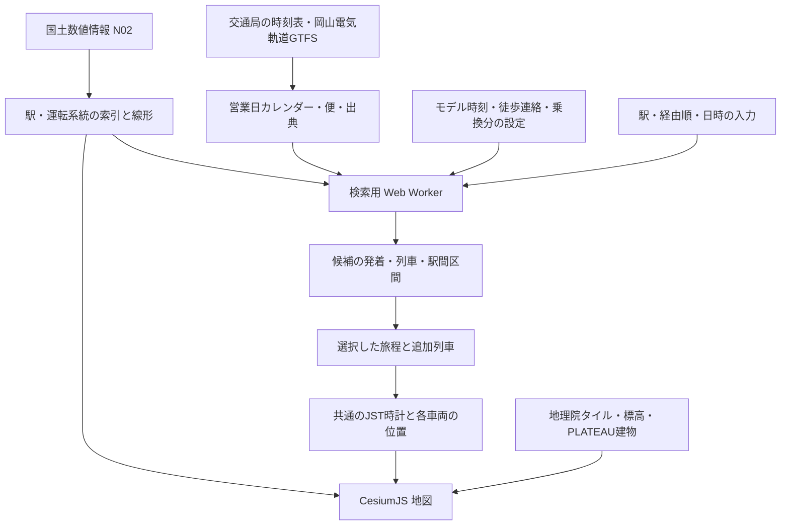

# データと処理の構成

このアプリは静的なWebサイトです。サーバーはビルド済みのファイルを配信します。経路検索、時刻の進行、列車の位置計算、描画は閲覧者のブラウザーで行います。GitHub Pages、AWS Amplify、ローカルのViteサーバーで同じデータを利用できます。主要機能にAPIキーは不要です。

## 駅、線路、乗換

`scripts/prepare-network.py` は日本全国版N02の駅形状と線路形状を事業者・路線単位で絞り込みます。`scripts/service_patterns.py` の停車順に合わせ、線路上の連結した頂点をDijkstra法で結びます。駅と駅の直線距離だけでは辺を作りません。都道府県や事業者で区別が必要な同名駅は別IDにします。[形状の作り方・原典・精度](NETWORK_DATA.md)

| 配布データ | 内容 | 読み込みのタイミング |
| --- | --- | --- |
| `public/data/network.json` と `okayama-network.json` | 駅ID、名称、都道府県、座標、系統、停車順、各駅間の形状キー・距離 | 初期化時に両方を読み、駅入力と検索で使用 |
| `public/data/timetable.json` | 便ごとの停車順、発着分、運転日の条件、出典 | 初期化時に読み込み、Workerへ転送 |
| `public/data/shapes/<系統ID>.json` | 形状キーを経度・緯度の座標列に対応づける表 | 経路・追加列車を描く際、その系統分を読み込み再利用 |
| `src/settings.json` | シミュレーション時刻の運転間隔、速度、停車分、列車間の乗換時間、確認した徒歩連絡 | ビルドに含め、検索時に使用 |

同じ駅で列車を替える場合は駅、列車種別、新幹線への乗換や事業者の違いをもとに必要時間を判定します。駅名が違う徒歩連絡は設定に列挙した組み合わせを使います。徒歩は所要時間に含め、列車の描画から外します。

## ダイヤの形式

`src/types.ts` の `Timetable` は出典・カレンダー・便に分かれます。一つの便には `id`、運転系統 `service`、運転日を指す `calendar`、出典ID `source`、駅の配列 `stops` があり、同じ添字の `arr` と `dep` がその駅の着分・発分です。午前0時から数えた分で記録し、営業日をまたいで走る列車では1440以上の値も扱います。

`scripts/prepare-timetables.py` は公開CSV・GTFSをこの形式に変換します。`src/routing.ts` は適用期間、曜日、例外日に合う便から乗車可能な駅間を生成します。公開便がないモデル系統では各系統の始終発、運転間隔、速度または個別所要分、停車分から両方向の便を作ります。実ダイヤを収録した系統の休止日や収録期間外には、モデル便を補っていません。元の資料や期間は出典IDから確認できます。[時刻表の収録範囲と再生成](TIMETABLE_SOURCES.md)

## 出発・到着・経由駅指定の検索

`src/search.worker.ts` はUIとは別のスレッドで、営業日単位の駅間データを用意します。最近使った営業日は再利用します。画面が新しい検索を開始した場合は、要求番号で古い結果を識別します。

1. 出発指定は指定時刻から24時間先まで、到着指定は24時間前から指定時刻までを対象に、前営業日から続く深夜便を含めて検索します。
2. 時刻順の接続スキャンで、出発指定は前から、到着指定は逆順に便をたどります。駅ごとに、直前の系統・訪問済みの経由駅数・発着時刻・乗車回数を保持します。同じ便に乗り続ける場合は乗換時間を加えません。
3. 経由駅は指定順に停車または到達した時点で次の段階に進みます。到着指定の逆向き検索では、経由指定も逆から照合するため、表示する旅程では入力した順を守れます。
4. 最早到着または最遅出発、少ない乗換、利用系統を変えた代替候補を探索します。同一の乗車経路をまとめ、成立した候補を最大3件返します。系統別距離の駅間合計は各候補の距離として表示します。

駅時刻表も同じWorkerで営業日ごとの便から作成します。乗換案内の比較リンクは、検索条件を外部サイトのURLに組み立てます。画面から取り込んだ外部の検索結果を自前のダイヤとして保存する処理はありません。

## 時計と複数列車の同期

時計の基準は `src/time.ts` のJST午前0時です。`src/main.tsx` は `requestAnimationFrame` で経過した現実時間に倍率を掛け、シミュレーション上の分を進めます。1～200倍の変更は、この進み方にだけ作用します。発着分や停車順は旅程に保存されます。

`src/playback.ts` は与えられた時刻を走行・停車・乗換待ち・徒歩連絡・到着のいずれかに対応させ、該当区間での進み具合を返します。走行中は短い加速・減速区間を設け、停車時は駅で位置を維持します。直接シークしても同じ関数で現在位置を求められます。

`src/traffic.ts` は手動追加された旅程に元の乗車日を残します。ある列車の位置を求めるときは、共通時刻から**その列車自身の乗車日のJST午前0時**を引きます。日付が異なる同時刻の便も区別できます。タイムラインはメイン列車と追加した旅程すべての最初の発車から最後の到着までです。追加列車は自身の発車前・到着後に非表示となり、選択中の旅程と完全に重複する便は重ねて描きません。追従・空撮・運転席はメイン列車を基準にします。

## 位置、3D地図、光

`src/data.ts` が検索結果の停車駅を系統内で探し、該当する駅間線形を連結します。逆方向は座標列を逆にたどります。`src/map-math.ts` は座標間の距離を累積し、その距離上に各車両を置きます。複数の車体を同じ向きのまま並べず、各車両の前後の線形から個別に向きを求めます。

`src/MapView.tsx` がReactの選択・時計・表示設定を地図へ渡し、`src/map.ts` がCesiumJSの描画とカメラを管理します。地理院の淡色地図と公開地形を使い、都市の建物は必要な範囲を3D Tilesで読み込みます。大阪駅周辺では同梱した建物・街路も利用します。WebGLを初期化できない場合は `src/local-map.ts` のCanvasに切り替え、簡易地図で経路を追跡します。

車両はGLB形式の共通モデルで、在来線、私鉄、新幹線、地下鉄、特急の5種があります。通常の3D表示では4両の車体を描き、遠くでは位置マーカーを使います。自動の昼夜モードは日付・位置ごとの太陽高度を使い、空、地図、車両照明を変えます。固定の昼・夕方・夜や5種のカメラは、検索や運行データとは独立した表示設定です。

## 全国への拡張と検証

新しいエリアでは、まず公的データから駅IDと実線形を作り、代表系統と確認済みの乗換を追加します。再配布可能な時刻表があれば、出典、適用期間、運休日、対応駅を確定して共通形式に変換します。検索用の索引と時刻表は初期読み込みなので、全国規模にする際は地域・日付単位のマニフェストを追加し、必要な地域を先にWorkerへ渡す構成に切り替えます。系統別の線形は現行方式のまま段階追加できます。

テストは `npm test`、型と配信用ファイルの確認は `npm run build` で実行します。地理データ、カレンダーと便の対応、経路検索、再生位置、3D線形・光の計算は `tests/` で確認できます。[GitHub Pages公開手順](DEPLOY_GITHUB_PAGES.md) ／ [AWSコンソールでの公開手順](AWS_CONSOLE_GUIDE.md)
